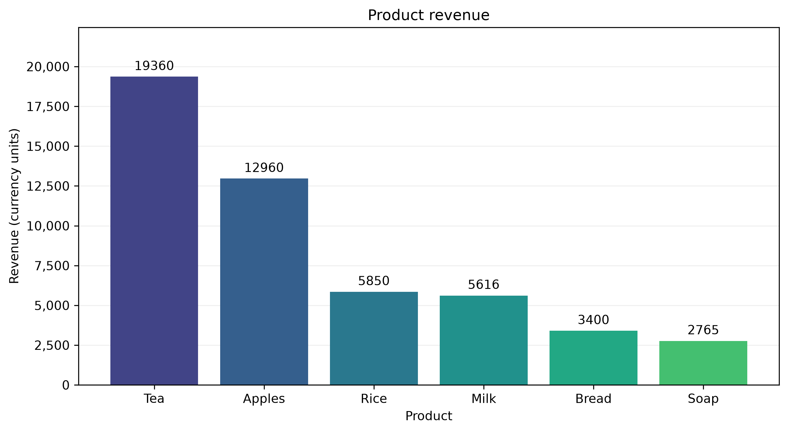
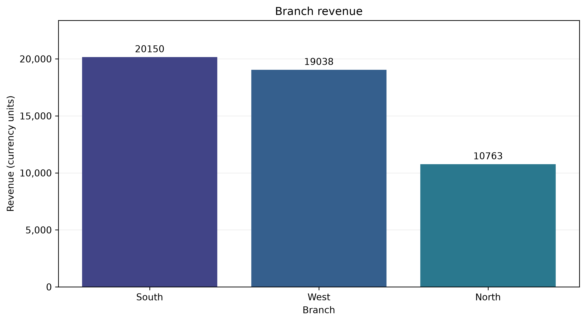
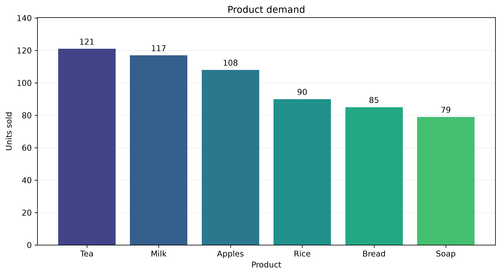
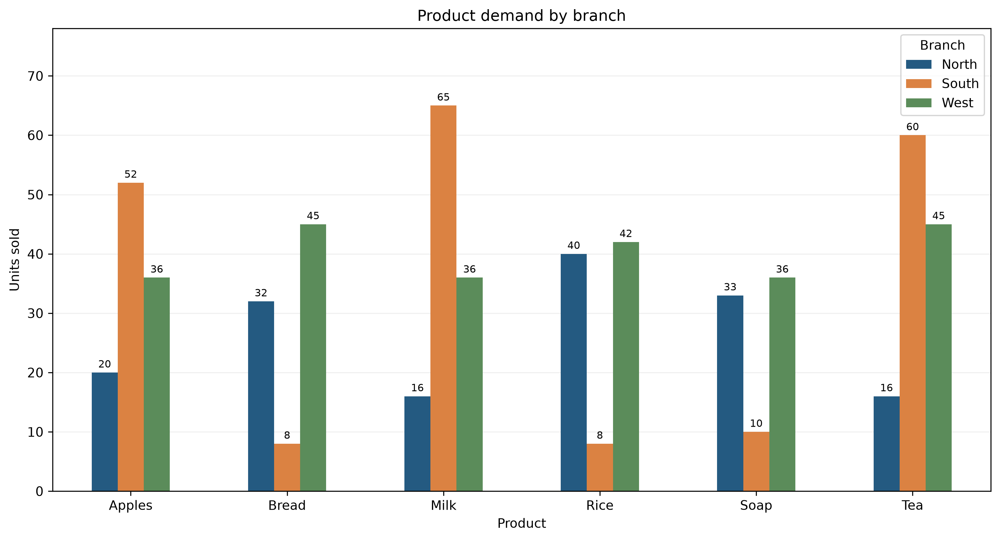

# 1. Activity Name

Apache Hive: Supermarket Sales Analysis. Analyze synthetic transaction lines for product and branch demand and revenue.

# 2. Problem Definition

A supermarket needs to understand which products and branches contribute revenue and how demand varies by location. Transaction lines require aggregation before managers can identify useful replenishment priorities.

# 3. Objectives

1. Load transaction data into a Hive table.
2. Calculate total sales revenue.
3. Rank products by revenue and quantity.
4. Compare branch sales.
5. Examine product demand within each branch.
6. Produce reproducible visualizations and qualified inventory recommendations.

# 4. Technology Study

Apache Hive provides SQL-like HiveQL for querying data stored in tables. HiveServer2 accepts client connections; Beeline is the command-line JDBC client. The metastore records table definitions and storage information. Hive translates HiveQL into execution plans and delegates processing to its configured execution engine. Its declarative aggregation is suitable for sales summaries and larger data-platform workflows. This exercise uses a single Docker container and a local Derby metastore; it does not demonstrate a distributed production deployment.

# 5. Architecture and Working

Docker runs HiveServer2; Beeline submits HiveQL to the server. A delimited managed sales table loads the mounted CSV, and Hive computes grouped results. See [architecture.mmd](architecture.mmd). If an existing workflow image is available, place it in this folder and reference it here.

# 6. Implementation and Procedure

The reproducible CSV has 120 sales lines with sale ID, date, branch, product, category, quantity and unit price. From the project root run `.\01_Hive\run.ps1` after starting Docker Desktop, then stop with `docker compose --profile hive down`. This existing script recreates the assignment table, so do not run it merely to regenerate charts. Generate figures with `.venv\Scripts\python.exe 01_Hive\graphs.py`. The chart script validates numeric fields and reconciles the reported totals against CSV.

# 7. Code, Queries and Configurations

The complete executable HiveQL is in [queries.hql](queries.hql), including database/table creation and local CSV loading. Core aggregations are:

```sql
SELECT 'TOTAL_REVENUE', SUM(quantity * unit_price) FROM sales;
SELECT product, SUM(quantity) AS units, SUM(quantity * unit_price) AS revenue
FROM sales GROUP BY product ORDER BY revenue DESC;
SELECT branch, SUM(quantity) AS units, SUM(quantity * unit_price) AS revenue
FROM sales GROUP BY branch ORDER BY revenue DESC;
SELECT branch, product, SUM(quantity) AS units
FROM sales GROUP BY branch, product ORDER BY branch, units DESC;
```

The root Compose file pins `apache/hive:4.0.1`, exposes port 10000 and mounts the Hive directory read-only at `/workspace`.

# 8. Outputs, Graphs and Images

CSV-derived and user-supplied Hive figures agree: total revenue 49,951; Tea 19,360; Apples 12,960; South 20,150; West 19,038; North 10,763. The supplied Hive transcript records the Beeline command but contains no query tables, so the historical execution results cannot be independently verified from that file.

1.  Figure 1: Product revenue, descending.
2.  Figure 2: Revenue by branch.
3.  Figure 3: Product demand by units.
4.  Figure 4: Units by product and branch.

SVG copies are alongside the PNGs. For actual execution screenshots, see [SCREENSHOTS.md](SCREENSHOTS.md).

Enhanced figures, generated by `advanced_graphs.py` from `sales.csv`, provide a ranked [revenue and contribution view](graphs/fig_1_1_product_contribution.png), [branch revenue and unit comparison](graphs/fig_1_2_branch_comparison.png), [branch-product heatmap](graphs/fig_1_3_branch_demand.png), and [daily revenue trend](graphs/fig_1_4_daily_revenue.png). The daily series describes only the 28 dates in this synthetic dataset; it does not establish seasonality. See [product summary](outputs/product_summary.csv) and [branch summary](outputs/branch_summary.csv) for revenue shares and counts.

# 9. Analysis and Interpretation

Tea leads product revenue at 19,360, followed by Apples at 12,960. South leads revenue with 20,150, while West leads volume with 240 units. Product demand differs: South sells 65 Milk and 60 Tea units, while West sells 45 Bread and 45 Tea units. Consider monitoring Tea and Milk availability in South and Bread and Tea in West, and compare with stock on hand, replenishment lead times and margins before ordering. Sales alone cannot determine exact reorder quantities.

# 10. Limitations

Data is synthetic and covers only 120 lines; dates, demand, stockouts and seasonality are not representative. Revenue is not profit. A single-container setup does not test distributed scalability. The available transcript has no results, so independent confirmation of Hive output requires a fresh capture.

# 11. Conclusion

The dataset supports reproducible HiveQL aggregations and four consistent sales views. Results identify different revenue and unit leaders, providing a starting point for branch-specific replenishment analysis.
